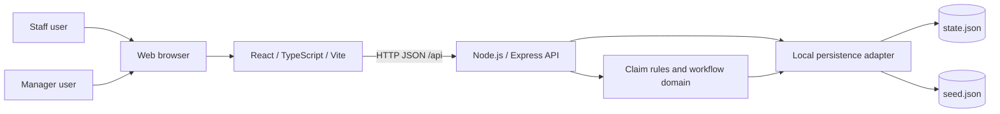
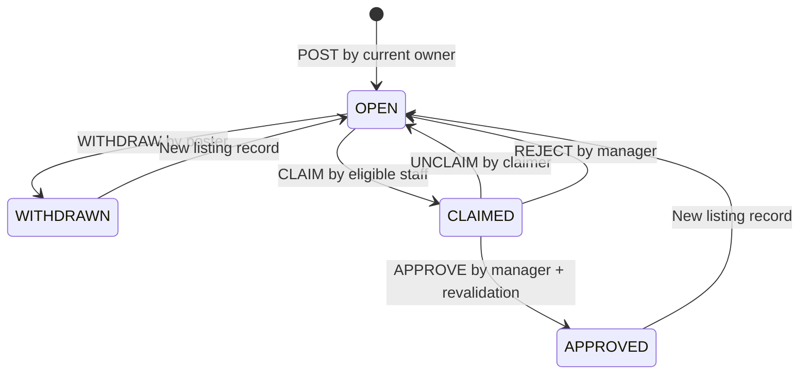
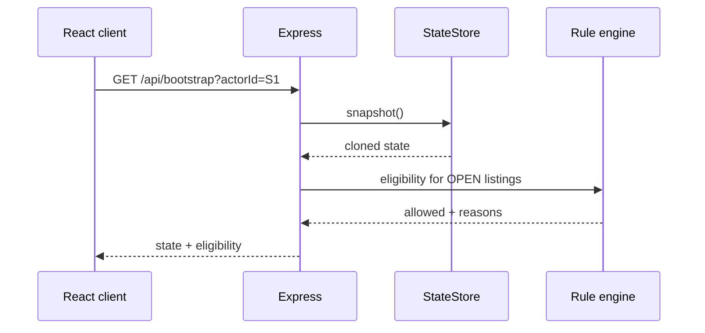
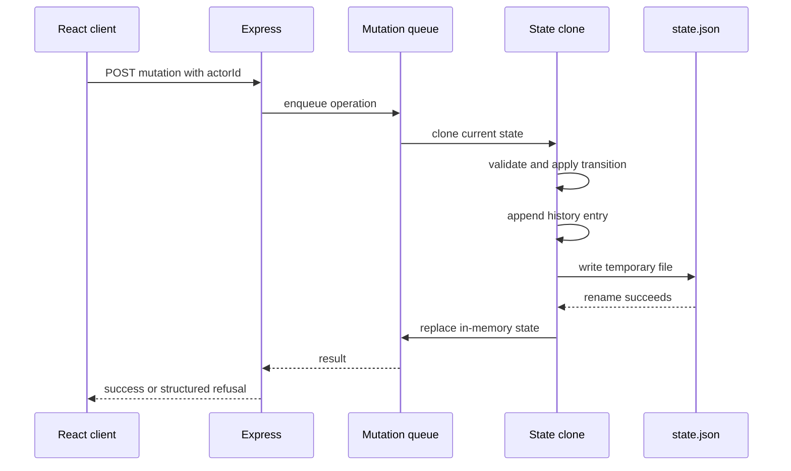
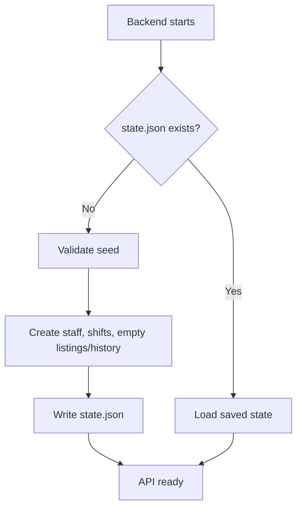

# ShiftSwap Architecture

## 1. Document purpose

This document describes the architecture of ShiftSwap at two levels:

- **High-Level Design (HLD):** system boundaries, components, data flow, persistence, deployment, and major design decisions.
- **Low-Level Design (LLD):** data structures, API contracts, state transitions, validation algorithms, mutation sequencing, and invariants.

The design is based on the current implementation in this repository.

## 2. Problem statement

CityCare Clinic has a weekly staff roster. A staff member may be unable to work an assigned shift and can post that shift for another staff member to claim. A manager must approve the change before ownership transfers.

The system must protect these labour rules:

- Staff cannot claim their own shifts.
- Required certifications must be held.
- Assigned shifts cannot overlap.
- At least 11 hours of rest is required between non-overlapping shifts.
- Staff cannot exceed 40 hours in the week where the target shift starts.
- A pending claim does not change ownership or count as an assignment.
- A manager approval must revalidate the current rules before reassignment.

## 3. Goals and non-goals

### Goals

- Provide a complete local staff-to-manager shift-swap workflow.
- Enforce all business rules on the backend.
- Preserve state and history across backend restarts.
- Return every applicable refusal reason in a structured format.
- Keep date and time calculations independent of timezone, daylight saving, and current date.
- Support a clear demonstration through the React UI and direct API calls.

### Non-goals

- Authentication or identity management.
- Multi-clinic tenancy.
- Notifications, email, or calendar integration.
- Production-scale distributed deployment.
- Multi-process concurrent writes to the same JSON file.

## 4. High-Level Design

### 4.1 System context



### 4.2 Runtime components

| Component | Responsibility | Technology | Source |
| --- | --- | --- | --- |
| Browser client | Actor selection, views, commands, feedback | React + TypeScript | `client/src/App.tsx` |
| Vite dev server | Frontend development server and `/api` proxy | Vite | `client/vite.config.ts` |
| HTTP API | Requests, responses, permissions, workflow actions | Express | `server/app.js` |
| Rule engine | Rules 1-5 and structured reasons | JavaScript modules | `server/rules.js` |
| Time service | Deterministic local timestamp arithmetic | JavaScript modules | `server/dateTime.js` |
| State store | Initialization, serialized writes, durable JSON state | Node.js filesystem | `server/store.js` |
| Seed dataset | First-run staff and roster | JSON | `server/seed.json` |
| Audit log | Persisted action outcomes and explanations | Part of state file | `server/app.js` |

### 4.3 Deployment topology

#### Local development

```text
Browser :5173 or :5174
    |
    | Vite proxy /api
    v
Express API :5000
    |
    v
server/data/state.json
```

The frontend and backend run as separate local processes. Vite forwards `/api` requests to Express during development.

#### Production-shaped local run

```text
Browser
    |
    v
Static client build
    |
    v
Express API :5000
    |
    v
Local state.json
```

The current repository does not include a production reverse proxy or a database deployment configuration.

## 5. Architecture principles

1. **Backend authority:** UI state never authorizes a mutation. Every mutation is validated again by the backend.
2. **Pure rule calculation:** date arithmetic and claim validation are isolated from HTTP and persistence.
3. **Explicit state transitions:** only the allowed listing transitions can change business state.
4. **Durable success:** a successful mutation is returned only after the new state is written.
5. **Auditability:** successful and refused attempts are retained in history.
6. **Deterministic schedule logic:** eligibility never depends on the server's current date, timezone, or daylight saving rules.
7. **Small local architecture:** the implementation avoids introducing a database or abstraction that is unnecessary for the hackathon's local scope.

## 6. Low-Level Design

### 6.1 Repository layout

```text
client/
  src/
    App.tsx          UI state, actor switching, workflows
    App.css          UI layout and visual design
    index.css        Global browser styles
    main.tsx         React bootstrap
  vite.config.ts     Vite config and API proxy

server/
  app.js             Express app, routes, permissions, transitions
  index.js           Server startup and shutdown
  db.js              Store adapter entry point
  store.js           Seed initialization and JSON persistence
  rules.js           Claim validation service
  dateTime.js        Local timestamp and interval helpers
  seed.json          Supplied initial data
  test/              Unit, integration, adversarial tests

README.md             Setup and user-facing project documentation
ARCHITECTURE.md       HLD and LLD documentation
AI_USAGE.md           AI assistance record
```

### 6.2 Domain entities

#### Staff

```typescript
Staff {
  id: string
  name: string
  role: "STAFF" | "MANAGER"
  certifications: string[]
}
```

#### Shift

```typescript
Shift {
  id: string
  start: string                 // YYYY-MM-DDTHH:MM
  end: string                   // YYYY-MM-DDTHH:MM
  required_certification: string | null
  assigned_to: string           // Staff.id
}
```

#### Listing

```typescript
Listing {
  id: string
  shiftId: string               // Shift.id
  posterId: string              // Staff.id
  status: "OPEN" | "CLAIMED" | "WITHDRAWN" | "APPROVED"
  claimerId: string | null      // Staff.id while CLAIMED or historical record
  createdAt: string             // ISO audit metadata
}
```

#### History entry

```typescript
HistoryEntry {
  id: string
  actorId: string
  actorName: string
  actorRole: string
  action: string
  shiftId?: string
  listingId?: string
  outcome: "SUCCESS" | "REFUSED"
  message: string
  reasons: ValidationReason[]
  previousStatus?: string
  resultingStatus?: string
  timestamp: string
}
```

#### Validation reason

```typescript
ValidationReason {
  rule: number
  message: string
  shiftId?: string
  requiredCertification?: string
  restMinutes?: number
  requiredRestMinutes?: number
  weeklyMinutes?: number
  limitMinutes?: number
}
```

### 6.3 Aggregate state

The persisted state is one JSON document:

```typescript
ApplicationState {
  staff: Staff[]
  shifts: Shift[]
  listings: Listing[]
  history: HistoryEntry[]
}
```

The state store clones the state before every mutation. A mutation operates on the clone and commits the clone only after durable write success.

### 6.4 State machine



`WITHDRAWN` and `APPROVED` are terminal states for an individual listing record. A later listing for the same shift is a new record.

### 6.5 Permission matrix

| Operation | STAFF | MANAGER | Additional condition |
| --- | --- | --- | --- |
| View state | Yes | Yes | Actor is selected from seed |
| Post | Yes | No | Staff owns shift and no active listing exists |
| Withdraw | Yes | No | Actor is poster and listing is `OPEN` |
| Claim | Yes | No | Actor differs from owner and Rules 1-5 pass |
| Unclaim | Yes | No | Actor is current claimer and listing is `CLAIMED` |
| Approve | No | Yes | Listing is `CLAIMED` and Rules 2-5 pass again |
| Reject | No | Yes | Listing is `CLAIMED` |
| View history | Yes | Yes | All actors can read audit history |

The API derives the actor role from persisted staff data. The client cannot supply a different role to bypass authorization.

## 7. Claim validation design

### 7.1 Validator contract

```text
validateClaim({
  claimer,
  targetShift,
  assignedShifts,
  enforceOwnerRule = true
})

returns:
{
  allowed: boolean,
  reasons: ValidationReason[]
}
```

### 7.2 Algorithm

```text
1. If owner rule is enabled and claimer.id == targetShift.assigned_to:
     return allowed=false with Rule 1 only.

2. If target requires a certification and claimer lacks it:
     append Rule 2.

3. For every currently assigned shift X:
     if X overlaps target:
         append Rule 3 with X.id.
     else:
         calculate rest gap.
         if gap < 660 minutes:
             append Rule 4 with X.id and actual gap.

4. Find Monday 00:00 for targetShift.start.
5. Sum full durations of assigned shifts whose starts are in that week.
6. Add the full target shift duration.
7. If total > 2400 minutes:
     append Rule 5 with calculated total.

8. Return allowed = reasons.length == 0 and all reasons.
```

### 7.3 Time representation

Input timestamps are local clinic values without timezone information. `dateTime.js` maps their calendar components into UTC minute values solely for arithmetic.

This supports:

- Overnight shifts
- Exact endpoint comparisons
- Exact 660-minute rest boundaries
- Monday week boundaries
- Full duration calculation across midnight
- Independence from the machine's local timezone

### 7.4 Assignment source of truth

The rule engine receives `state.shifts.filter(shift => shift.assigned_to === claimer.id)`.

Therefore:

- A pending claim is not included because it has not changed `assigned_to`.
- A shift with an `OPEN` or `CLAIMED` listing is still included because ownership has not changed.
- A shift is counted for the new owner only after approval changes `assigned_to`.

## 8. API and request processing

### 8.1 Read flow



### 8.2 Mutation flow



If validation fails, business state is unchanged, but the refusal is recorded in the draft and persisted as an audit event.

### 8.3 Endpoint contract

```text
GET  /api/health
GET  /api/ready
GET  /api/bootstrap?actorId={staffId}
GET  /api/staff
GET  /api/shifts
GET  /api/listings
GET  /api/history

POST /api/listings
POST /api/listings/:id/withdraw
POST /api/listings/:id/claim
POST /api/listings/:id/unclaim
POST /api/listings/:id/approve
POST /api/listings/:id/reject
```

All mutation requests use JSON and include:

```json
{
  "actorId": "S1"
}
```

The post endpoint also requires:

```json
{
  "shiftId": "SH001"
}
```

### 8.4 Error response shape

```json
{
  "error": "Claim is not permitted.",
  "reasons": [
    {
      "rule": 4,
      "message": "Only 8 hours of rest before or after SH007; 11 hours are required.",
      "shiftId": "SH007",
      "restMinutes": 480,
      "requiredRestMinutes": 660
    }
  ]
}
```

A stale claim uses the required exact response message:

```json
{
  "error": "no longer available",
  "reasons": []
}
```

## 9. Persistence and consistency

### 9.1 First-run initialization



### 9.2 Atomic write behavior

The store writes to `state.json.tmp` and then renames the temporary file to `state.json`. This reduces the chance of leaving a partially written final document.

The in-memory state is changed only after the write succeeds. A failed write therefore does not create a phantom in-memory transition.

### 9.3 Concurrency model

The store maintains a promise queue:

```text
mutation 1 -> mutation 2 -> mutation 3 -> ...
```

This protects mutations handled by the same Node.js process. It guarantees that concurrent claim requests observe a serialized order, so at most one can transition an `OPEN` listing to `CLAIMED`.

The design does not provide a cross-process lock. Multiple backend processes must not share the same JSON file.

## 10. Invariants

The following invariants must hold after every successful or refused mutation:

1. Every listing references an existing shift.
2. Every poster and claimer reference points to an existing staff member when present.
3. Each shift has at most one `OPEN` or `CLAIMED` listing.
4. `OPEN`, `CLAIMED`, and `WITHDRAWN` transitions do not change shift ownership.
5. Only `APPROVED` changes shift ownership.
6. Managers are never assigned shifts by this workflow.
7. A `CLAIMED` listing has a current claimer.
8. `OPEN`, `WITHDRAWN`, and `APPROVED` listings have no active claimer.
9. Failed claim and approval operations do not partially reassign a shift.
10. History entries are retained after reopening or approval.

## 11. Security and trust boundaries

This is a demonstration application without authentication. Actor selection is therefore a UI convenience, not an identity boundary.

The backend still enforces role and ownership checks using the persisted staff record. A user cannot become a manager by sending a different role in a request because the API accepts only `actorId` and resolves the role server-side.

For production use, the actor would come from an authenticated session or access token rather than a client-selected ID.

## 12. Observability and auditability

The current application provides:

- `/api/health` for liveness
- `/api/ready` for readiness status
- Persistent action history for business auditing
- Structured rule reasons for refused claims and approvals
- Console logging for unexpected server errors

A production deployment would add structured logs, metrics, request IDs, and centralized error reporting.

## 13. Testing strategy

The test architecture has three layers:

### Unit tests

Test deterministic date helpers and claim rules with controlled fixtures.

### API and workflow tests

Use Supertest and temporary state files to exercise real Express routes, permissions, state transitions, approval revalidation, persistence, and concurrent requests.

### Independent verification

`server/test/deep.test.js` implements separate reference calculations for timestamp parsing, overlap, rest, and weekly hours. It compares expected rule numbers with the production validator and runs deterministic generated fixtures.

Commands:

```powershell
npm test
npm run build
npm run lint
```

Current verified results:

```text
npm test       20 passing
npm run build  successful
npm run lint   no errors
```

## 14. Design decisions and tradeoffs

### Local JSON instead of MongoDB

The starter repository included Mongoose, but the application requirement is local, self-contained execution. JSON persistence avoids requiring a separate database service and makes first-run initialization and reset simple.

Tradeoff: JSON storage is not suitable for multiple backend processes or production-scale workloads.

### Single aggregate document

Staff, shifts, listings, and history are stored together. This makes the hackathon workflow easy to inspect and allows one serialized mutation to preserve cross-entity invariants.

Tradeoff: the entire document is read and written for each mutation.

### Backend-calculated eligibility

The frontend receives eligibility information for display, but the backend recalculates it during claim and approval. This prevents stale or manipulated frontend state from authorizing a transition.

### Historical listing records

Listings are never deleted or recycled. Reopening after rejection or unclaiming changes the same active record back to `OPEN`, while `WITHDRAWN` and `APPROVED` records remain historical. A later post creates a new listing record.

## 15. Future production evolution

A production version would likely add:

- Authenticated staff and manager identities
- PostgreSQL or another transactional database
- Database-level uniqueness for active listings
- Row locks or optimistic concurrency versions
- Structured logging and monitoring
- Notifications for claims and approvals
- Calendar export and roster integrations
- Database migrations and operational backups
